# Product Exploration: Orange Slice and Clay

Scope and honesty note: Orange Slice includes a hands-on session on the free plan (19 Oct 2026) with screenshots. Clay also has a hands-on session on the free plan (19 Oct 2026); its homepage (read 18 Oct 2026) was used for features I did not test. The Outmate Loom walkthrough of Orange Slice was also used.

Links: https://www.orangeslice.ai/ , https://www.clay.com/

## What problem each product solves

- Orange Slice: lets a team describe a go-to-market task in plain English and have AI agents prospect, enrich, qualify and act on leads, so people do not hand-build lead lists.
- Clay: "infrastructure to get any data, run agentic workflows, and launch GTM plays" (homepage wording). It combines many data providers and agents on one canvas.

## How a user starts

- Orange Slice: type a plain-English request (homepage example: "Find me 50 Series A fintech companies in NYC that just hired a Head of Sales"), start from a prebuilt use-case workflow, or @mention it in Slack. In the Loom: a prompt like "companies using HubSpot or Salesforce with 50 to 500 employees" produces a table.
- Clay: sign up free, then use a "What do you want to build?" prompt box (examples: find phone numbers for controllers in the US or UK, find companies with 3+ open roles mentioning international expansion), build with clicks, code or chat on a visual canvas, or use a plugin, CLI or API from a coding agent.

## Inputs

- Orange Slice: natural-language prompts (an ICP description, or a request for new enrichment columns). No file upload mentioned on the homepage.
- Clay: filters, first- and third-party data (Audiences), CRM records, and signals such as job changes and intent. Detailed input formats are not described on the homepage.

## How companies and contacts are discovered

- Orange Slice: a lead generation agent searches the web and checks each company against the user's criteria. Listed sources include funding news, job postings, VC portfolios, conferences, local business data and social sites. Listed providers include Firecrawl, Apify, PredictLeads, BetterContact, FullEnrich and BuiltWith.
- Clay: TAM sourcing with filters, a data marketplace of 200+ providers under one contract, plus "find people", "find company" and "find jobs" search, and Claygent for AI research.

## How enrichment works

- Orange Slice: each column is a natural-language prompt to an AI agent that browses the web for live data. Agents run in parallel across rows.
- Clay: waterfall enrichment across multiple providers for coverage (named on the homepage, mechanics not explained), plus Claygent AI research.

## Results, filtering and export

- Orange Slice: spreadsheet-style table with progress counters (for example 247 / 500), multi-criteria filtering and instant export. Columns can also push data out (Salesforce sync, outbound sequences, emails).
- Clay: table views with filters (for example title contains VP or Director), tiering such as T1 to T3, and exports or syncs to ad platforms, campaigns and workflows.

## Agents, workflows or spreadsheet?

- Orange Slice: all three. Agents per column, workflows that trigger actions, and a spreadsheet-like view.
- Clay: tables on a visual canvas, workflows, and agent products (Claygent, account agents, an inbound SDR agent).

## Pricing

- Orange Slice: free to start and credit-based (a Slack example mentions about 20 credits for 20 contacts). The Loom confirms a credit cost is shown per run.
- Clay: free trial, no card required. Pricing details are on a separate page not covered here.

## Hands-on session: Orange Slice (19 Oct 2026, free plan)

Prompt used (the one from the Loom):

```
Find companies using HubSpot or Salesforce with 50 to 500 employees
```


What happened:
- The agent built a spreadsheet workspace ("Companies with CRM platforms and employees", sheet "Leads") with 119 rows. Its summary line read "Modified 7 columns, 9 operations".
- Columns seen: Domain, Tech Detected (HubSpot or Salesforce), Company Name (BuiltWith), LinkedIn Enrichment (a JSON object with fields such as company_size and country_code), LinkedIn URL, and In Employee Range (true or false). Status read "Last run 714/714 cells".
- Cost: about 453 credits for this one prompt, on a visible balance of 1,552 credits (free plan).
- The agent explained coverage in the chat: only 8 of the 119 domains fell in the 50 to 500 range, 73 were not found in the LinkedIn data, and BuiltWith's test environment returned only 60 results per technology. It offered to pull more pages, or to enrich the rows with decision-maker contacts and job titles.
- The sheet has Filter, Sort (sorted by 2 fields), Sheet and Workflow views, and Export (Add to Database, CSV / Excel, Custom API).
- A "first reply" checklist leads the user onward: Find leads, Find emails and LinkedIn, Connect LinkedIn and email, Launch outreach, Get your first reply.

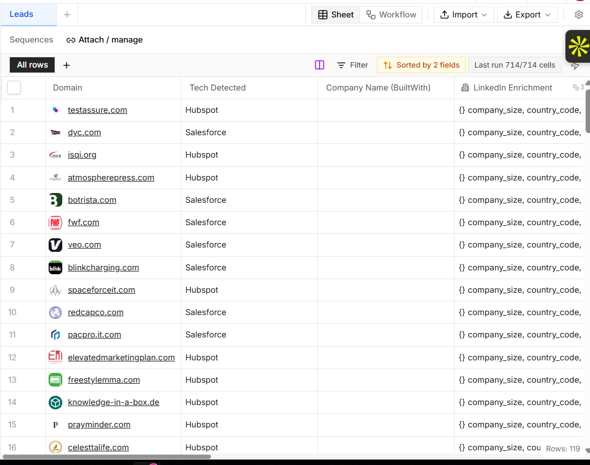
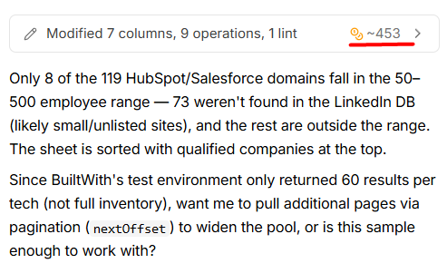
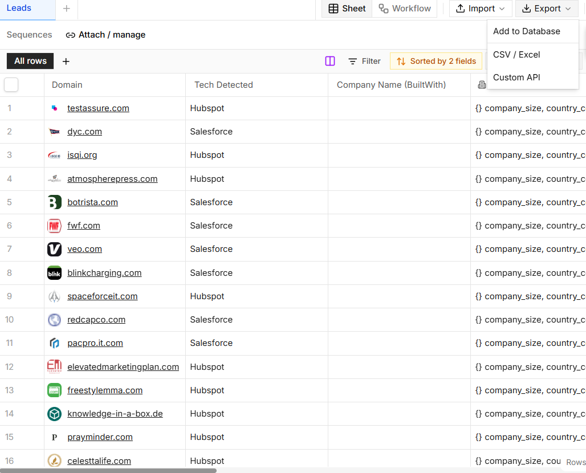

Agent steps and credit breakdown (from the operations log):
- Fetch companies using HubSpot/Salesforce: about 200 credits. Dedupe domains: about 200. Sample run on a few rows: about 5. Full run on all rows: about 48. Total about 453.
- The agent first failed one column edit ("LinkedIn Enrichment"), recovered, then created columns for Employee Count, Company Name, Industry, LinkedIn URL and In Employee Range (50-500). It ran a small sample before the full run.

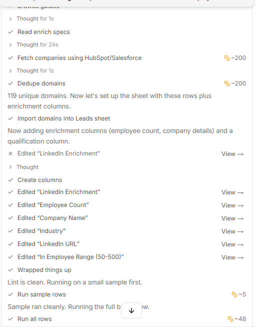

Cell detail (clicked one LinkedIn Enrichment cell):
- The side panel shows the JSON as labelled fields: name, region, industry, locality, company_size, country_code, linkedin_url, employee_count. For the row opened (Detroit Yacht Club), region, industry, company_size and country_code were empty ("-") while employee_count was 74.
- A "Visualized JSON" view and "Edit raw JSON" option exist. The only provenance shown is the LinkedIn URL inside the data. There is no per-field source or confidence label, and missing values are just a dash.

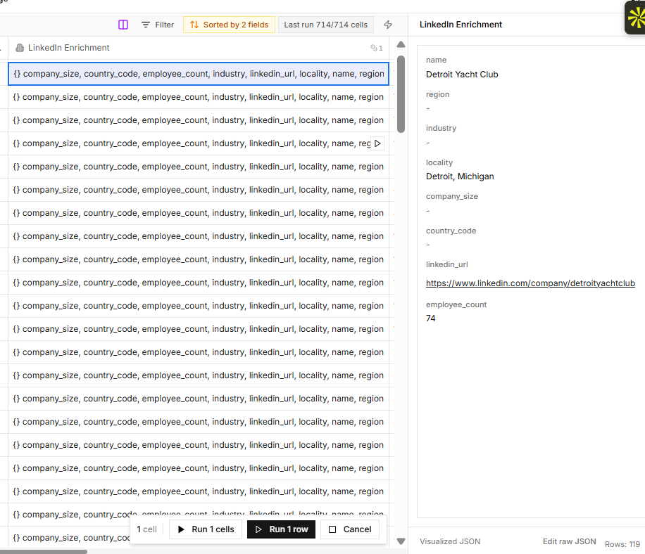

What I noticed:
1. The unit of work is a sheet of many rows. A single-company report is not the primary view.
2. Discovery used a technology-install source (BuiltWith) and size came from LinkedIn data, so each column comes from a different provider.
3. On the main sheet, enrichment cells show raw JSON objects, and I did not see a source URL or confidence label per cell. Not found and out of range both appear as false in the boolean column, and the explanation lives only in the chat message. The cell detail view confirms it: fields are listed, empty ones show a dash, and there is no per-field source or confidence.
4. Cost is visible per prompt, which is useful for Outmate's own pricing design.
5. The chat is honest about coverage gaps (8 of 119). The table itself does not carry that per field.

## Hands-on session: Clay (19 Oct 2026, free plan)

Prompt used (same as Orange Slice, with the Sculptor prompt box under "Create source"):

```
Find companies using HubSpot or Salesforce with 50 to 500 employees
```

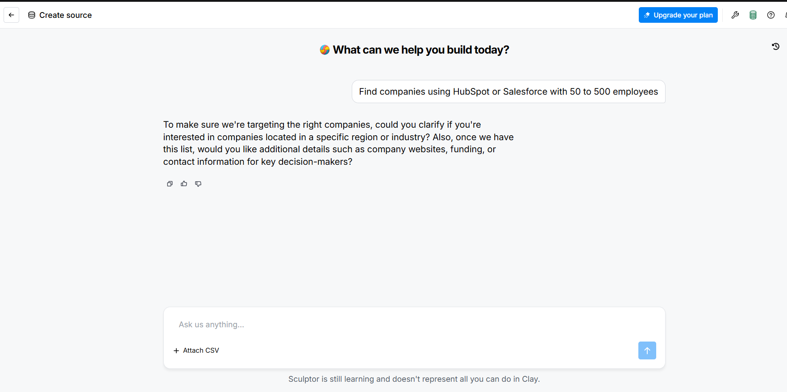

What happened:
- Clay's assistant (Sculptor) did not build anything at first. It asked whether I wanted a region or industry, and whether to add company websites, funding or contacts. I answered "any industry and any region worldwide, just company name, website and employee count, no funding or contacts".
- It then generated search criteria and opened a "Find Companies" source. Criteria shown: tech stack vendor is HubSpot or Salesforce, and company size is 51-200 or 201-500 employees. Note that Clay's size buckets (51-200, 201-500) are coarser than the 50 to 500 I asked for.
- Preview: "50 of 172,112 found". Columns visible: Name, Description, Primary industry, Size, Type (for example Privately held, Nonprofit, Educational), location, country and a LinkedIn link.
- Two steps from prompt to table (prompt, then one clarifying exchange). It felt faster than Orange Slice, which built a full sheet of 119 rows directly.
- Save options: Save to Audiences (up to 1M results), Save to table (up to 1K), Enrich (send up to 1K to an enrichment workflow), or Start a new workflow. The default is "Max available".
- Credits: the workspace badge showed "1,000 / 1K credits available" and the Usage page showed no balance data. I could not tell whether the preview spent any credits, because the usage page recorded nothing. No paywall was hit.

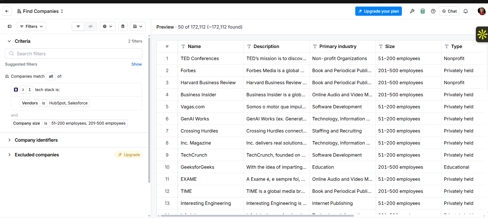
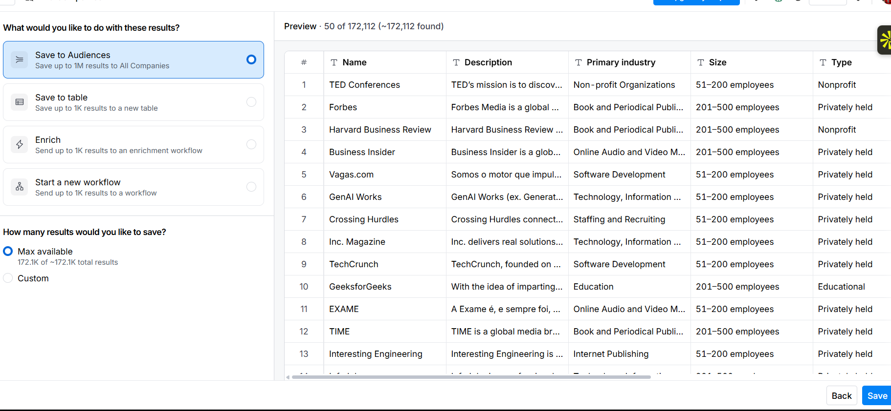
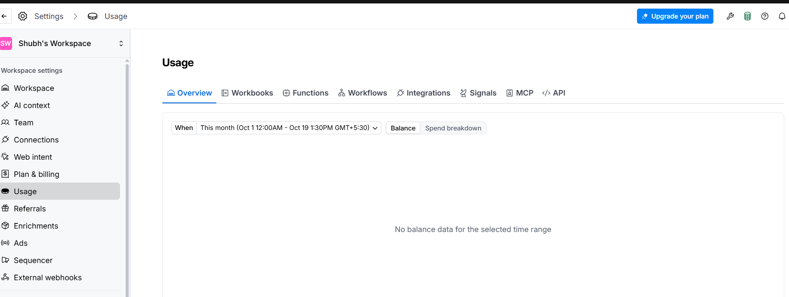
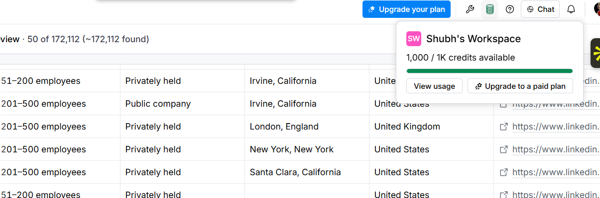

What I noticed:
1. Clay asks a clarifying question first instead of acting. It gives the user a chance to scope, which is good for cost and relevance.
2. The criteria are shown as editable filters, so the user can see and change exactly what was searched. This is more transparent about the query than Orange Slice, but still not about each value.
3. No source or confidence is shown per cell in the preview. The empty-location row (Y Combinator) had a blank location and no explanation.

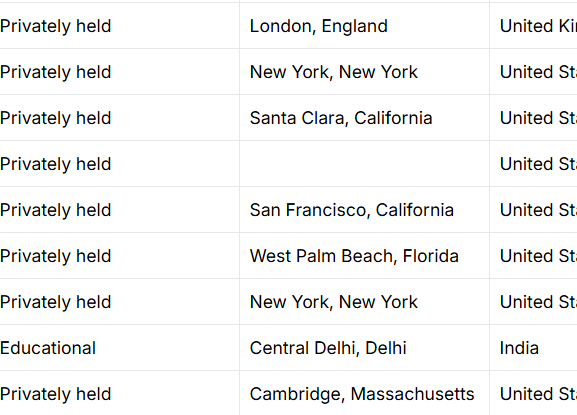

4. Clay reports a very large total (172,112) as a preview and makes saving an explicit step with a size choice. Orange Slice spent credits and returned a finished sheet in one go.
5. Not checked: the enriched table after saving, any per-cell detail view, or per-step credit costs. I did not save the table, to avoid spending credits.

## Feature comparison

| Feature | Orange Slice | Clay | This prototype |
|:--|:--|:--|:--|
| Natural-language prospecting | Yes (tested: agent built the sheet from one prompt) | Yes (tested: asks a clarifying question, then builds filters and a preview) | No, out of scope |
| Single-company research report | Via row research columns | Via Claygent | Yes, the core feature |
| Spreadsheet-style table | Yes (tested) | Preview table, then Save to table or Audiences (tested) | No, report page instead |
| Waterfall or multi-provider enrichment | Multiple sources in one run (BuiltWith for tech, LinkedIn data for size) | Named feature on the homepage (not tested) | Adapter interface ready (Exa now, others pluggable) |
| AI agents | Yes, per column | Yes, Claygent and others | One grounded LLM step, no agents |
| Source URL per claim | Not visible on the sheet (cells show values or raw JSON) | Not seen in the preview; blank cells unexplained | Yes, every field |
| Explicit trust status per field | Not seen (coverage explained in chat only) | Not seen | Yes (verified, provider-reported, inferred, unavailable) |
| Quote check against the source | Not shown on homepage | Not shown on homepage | Yes, unsupported claims are dropped |
| Credit pricing | Yes (about 453 credits for the first prompt, balance 1,552 on free plan) | Yes (1,000 free credits shown; usage page showed no spend for the preview) | Free tiers only |
| Export | CSV / Excel, Add to Database, Custom API | Save to Audiences or table, or send to workflow | JSON copy and download |
| Actions (CRM sync, outreach) | Yes | Yes | No, out of scope |

## Workflow observations

1. Both products treat enrichment as repeated, parallel lookups per row. The unit of work is a table, not a single report.
2. Both lean on AI agents and provider lookups, which is flexible but makes it hard to tell where a value came from. In the Orange Slice session, coverage gaps (73 of 119 not found) were explained in chat but not marked per cell. Neither homepage shows per-claim sources or confidence.
3. Both blend discovery, enrichment and action in one place. That is the full platform, so the first prototype should isolate just the trustworthy research and enrichment step.
4. Credits make cost visible per run, which matters for Outmate's pricing design later.

## Recommendation for Outmate's first version

Build the single-company, evidence-first research report first:
- It is the smallest slice that proves the hardest part, trustworthy enrichment.
- Provider adapters let Outmate plug in Exa, MoltSets and others and compare coverage, which is the same idea as waterfall enrichment.
- Per-field status and sources are a visible differentiator against tools that return clean tables without provenance.
- The report is a natural row-level building block. Next step: run it across many rows in a spreadsheet-style view, then add natural-language prospecting on top.

## Checklist before submitting

- [x] Try Orange Slice once with the HubSpot or Salesforce prompt, capture screenshots (input, results table, credits, export). Done 19 Oct.
- [x] Cell detail and credit breakdown captured.
- [x] Clay free plan tried with the same prompt, screenshots captured (19 Oct). The saved-table view and enrichment columns were not tested.
- [ ] Correct anything above that the real product contradicts.
- [ ] Put screenshots in docs/screenshots/ and link them here.
